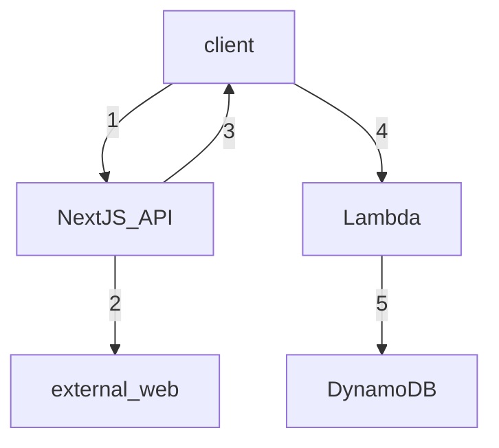

Cruzable -- currently just ListIt, but eventually a collection of random apps.

Deployed automagically to vercel.

Setup:

- nodejs v18
- typescript
- eslint and prettier. (only lint issues block the build)
- npm (not yarn)
- nextjs
- google oauth (ask alan for the credentials, they are not pushed up to the repo)

How does list it work?
- AWS infrastructure, (different repo, currently only local to Alan -- will eventually push it up).

Simplified flow diagram for scraping

Steps for dev

Note: you will need a `.env` with the google oauth credentials. Otherwise, just comment out the authentication pieces and hardcode the `session.user.email` stuff to be your email

- npm i
- npm run dev

Remember to run

`npm run build`

before pushing to main. If `npm run build` passes locally that means the deployment will succeed. otherwise you need to look at the logs in vercel.
